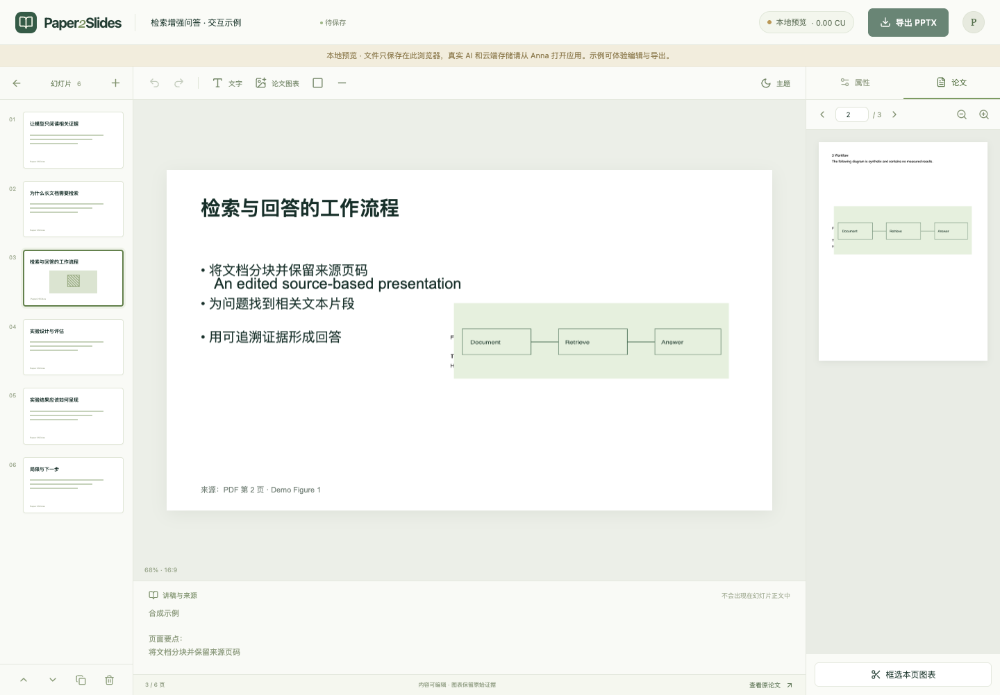

# Paper2Slides

把 AI／计算机领域的文字型论文 PDF 转为可编辑的组会汇报 PPT。使用 Anna 平台的模型与 APS 存储，不需要额外模型 API Key 或自建后端。

## 交付信息

- GitHub：<https://github.com/xingkai-song/paper2slides>
- Anna App name：**Paper2Slides**
- slug：`paper2slides-ai`，命名空间：`@xingkai-song/paper2slides-ai`
- staging开发者控制台：<https://staging.anna.partners/developer?app=257>
- 候选版本：`1.0.3`；上线状态见[发布记录](docs/RELEASE-STATUS.md)。

## 产品流程

上传 PDF → AI 识别正文范围 → 用户核验 → 设置场景／时长／语言 → AI 提炼证据、生成大纲并推荐图表 → 核验裁剪 → 自由编辑 → 下载 PPTX。

- 文件最多20MB，正文最多50页，允许PDF总页数超过50页。
- 正文超过50页时拒绝生成，不支持裁掉正文绕过限制。范围修正需要提供依据并通过AI复核。
- 图表保留原图及来源页码，文字与形状导出为原生可编辑对象。
- 支持文字、图片、矩形、线条的移动、缩放、旋转、图层及样式调整，50步撤销／重做。
- PDF、图表、内容和布局保存在Anna；未同步编辑暂存IndexedDB。
- 来源关联是可追溯性检查，不等于自动事实核验。

## 本地开发

需要 Node.js 22+、npm。Anna开发环境另需 `uv` 和官方 `@anna-ai/cli`。

```bash
npm ci
npm run dev
```

本地Vite模式只使用浏览器IndexedDB，不调用真实AI、不假称云端保存。点击“打开示例”可体验完整画布和导出。示例PDF为合成材料，没有真实实验结论。

```bash
npm test
npm run test:e2e
npm run build
anna-app validate --strict
```

端到端测试默认使用本机Chrome；未安装时可以安装Chrome，或修改Playwright配置后使用其管理的Chromium。三篇公开论文解析测试在存在 `.local/attention.pdf`、`.local/lora.pdf`、`.local/rag.pdf` 时运行，否则显式跳过。公开论文不包含在仓库中。

## Anna staging开发与发布

```bash
npm install -g @anna-ai/cli
anna-app login --host https://staging.anna.partners
anna-app whoami
npm run build
anna-app apps push --account https://staging.anna.partners
anna-app dev --slug paper2slides-ai --bundle bundle --storage aps \
  --llm-account https://staging.anna.partners --llm-app-slug paper2slides-ai
```

CLI 0.1.63没有 `--llm real` 参数；登录后的默认模式即真实模型桥接。实测平台文件桶不允许localhost跨域PUT，所以完整文件上传／恢复／下载验收必须在staging工作草稿或候选版本中完成。

```bash
anna-app apps cut 1.0.4 --account https://staging.anna.partners
anna-app apps submit-review --account https://staging.anna.partners
anna-app apps status paper2slides-ai --account https://staging.anna.partners --json
# 等待平台审核通过后：
anna-app apps release 1.0.4 --account https://staging.anna.partners
```

以上1.0.4是下一版本示例；当前1.0.3已固定并在审核，审核通过后发布现有版本时使用 `anna-app apps release 1.0.3 --account https://staging.anna.partners`。版本号应高于已存在版本。`push`仅上传工作草稿，`cut`创建不可变版本，`submit-review`送审，`release`上架。平台可能在审核通过时直接发布；以实际 `PUBLISHED` 状态为准。

控制台：<https://staging.anna.partners/developer>

不要提交 `~/.config/anna/credentials.json`、PAT、浏览器会话或 `.anna/` 身份缓存。`manifest.json`中允许的R2源来自实测平台文件地址，部署到其他环境时应检查并更新。

## 当前模型与测试

所有文本和图表图片调用均明确指定 `xiaomi/mimo-v2.5`，关闭可选推理，按实际返回记录Token与CU。已有项目缓存不会因模型配置变化自动重做。

本轮31项单元测试、6项端到端测试及构建通过。真实三篇论文基线和修改后的复测范围、耗时、用量与已知限制见 [测试基线](docs/qa/2026-11-06/README.md) 和 [修改复测](docs/qa/2026-11-06/fix-report.md)。

## 架构

- React + TypeScript + Vite；Zustand管理编辑状态。
- PDF.js在浏览器提取文本、重建阅读顺序、渲染和裁图。
- Anna SDK完成 `llm.complete`、KV、文件上传读取及宿主下载。
- Zod校验AI输出；短原文片段与PDF页码校验引用。
- React Konva自由画布，PptxGenJS将同一元素模型映射到PPTX。
- APS索引＋不可变项目快照＋上一版本恢复；etag避免静默覆盖。

详细行为与限制见 [架构](docs/ARCHITECTURE.md)、[隐私说明](docs/PRIVACY.md) 和 [验证记录](docs/VALIDATION.md)。

## 限制

扫描件OCR、自动重绘图表、字符级富文本、公式转可编辑公式、动画和多人协作暂不支持。PDF阅读顺序与视觉定位依赖版式，复杂布局需人工核验。视觉模型不可用时保留基于图注的AI推荐，用户手动框选。平台宿主下载之外还提供主动保存文件按钮，兼容浏览器阻止自动下载的情况。PPTX字体未嵌入，打开后的字体和换行可能因系统而异。

最近核验的平台状态：1.0.3 已提交审核（`pending_review`），尚未公开上架。GitHub Actions 因账号计费锁定未启动，本机验证均已通过，详见[验证记录](docs/VALIDATION.md)。

编辑器预览（本地合成示例）：


