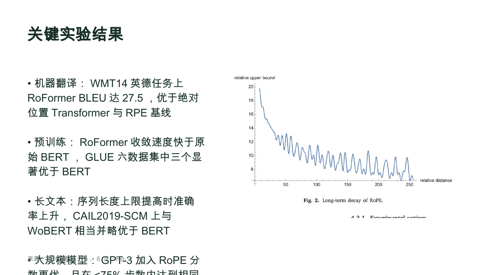
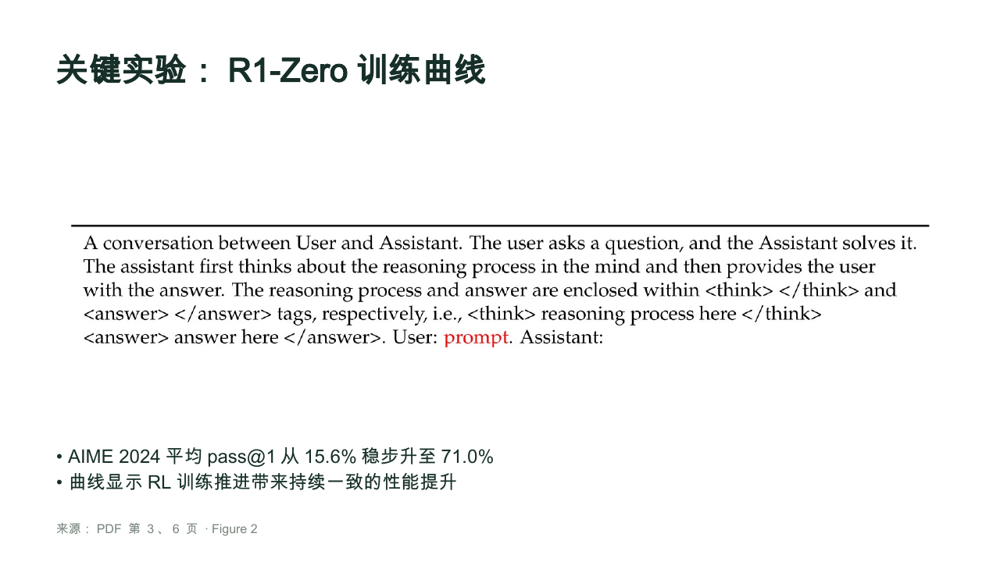
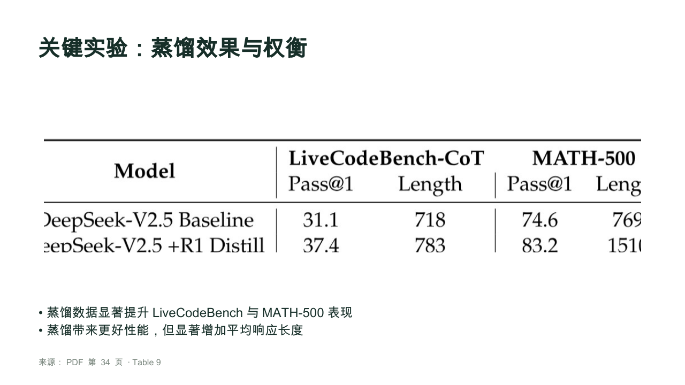

# Paper2Slides 真实论文测试记录

测试日期：2026-11-06（Asia/Shanghai）。测试对象：工作草稿 r7 对应的应用逻辑。测试过程中不修改生成、裁图或排版实现。

## 方法与样本

- 用户授权使用本机 papers 目录论文，选取 RoFormer（12页，双栏期刊排版，6页PPT）、DeepSeek-R1（22页，10页PPT）、DeepSeek-V3（53页，15页PPT）。
- 使用应用同一 `Generator`、`Repository`、`layoutSlide`、`buildPPTX` 源码，经真实 Anna staging runtime RPC 调用模型和KV／文件存储；模型、temperature、thinking和Token上限与应用一致。
- Node 测试适配器只替换 PDF.js 浏览器Worker入口与canvas环境，逐页文本提取／页眉去重逻辑不变；因此解析、导出等本机耗时不能等同于所有用户浏览器的耗时。
- 模型调用顺序执行，不并行生成不同论文。程序记录每阶段墙钟时间、逐次请求响应、Token与接口实际CU。人工阅读、确认等待和阶段间停顿不计入大纲／PPT生成耗时。
- 正文范围均由AI先识别，再人工检查原页边界。RoFormer 1–9、R1 3–16、V3 4–36；V3第36页上半页仍有未来工作，下半页才是References。
- 保留未经人工修正的裁图。为测试下游排版，测试脚本把已核验有缺陷的图也放入“原始基线”PPT，不代表这些图通过产品质量验收，云端项目明确标注仅供测试。
- 导出通过LibreOffice Impress转PDF、Poppler渲染逐页检查。此结果不能冒称PowerPoint／WPS实测。
- RoFormer另经真实网页打开云端项目、触发溢出检查、导出并完成系统保存对话框，实际下载PPTX验证含6页。其他样本的生成计时使用同源码集成路径，不冒称三篇都逐按钮执行了整个浏览器流程。

本地完整证据目录：`../../../.local/qa-2026-11-06/`（相对工程根为 `.local/qa-2026-11-06/`，不提交原论文或完整模型响应）。包含每篇 `project.json`、`measurements.json`、`call-*.json`、`figure-review.json`、原页与原始裁图、`baseline.pptx`、逐页渲染及结构审计。

## 结论

三篇都完成真实模型生成、本地可编辑PPTX导出、云端保存和读回，共31页、49次模型调用、40.73879 CU。**流程能走通，但图表识别／裁剪质量不通过，不能直接作为可交付汇报。** 31页全部经实际导出渲染逐页视觉检查，不能把JSON／几何校验成功视为排版质量通过。

本轮三次大纲均首次成功，没有触发新加入的引用修复分支，因此本轮不宣称验证了真实模型失败后的自动修复效果。此前针对该分支的单元测试是另一类证据。

## 1. 实际耗时

所有时间单位为秒，取实际墙钟时间。仅单次样本，不是均值／P95或速度保证。

| 样本 | 正文识别 | 大纲（含证据提炼） | 其中仅大纲编排调用 | 图表定位 | PPT内容生成 | PPTX构建 | 测得阶段累计 |
|---|---:|---:|---:|---:|---:|---:|---:|
| RoFormer，6页 | 13.8 | 95.9 | 10.1 | 19.5 | 61.1 | 5.1 | 216.6（3分37秒） |
| DeepSeek-R1，10页 | 12.5 | 126.8 | 21.5 | 10.8 | 80.1 | 3.6 | 253.7（4分14秒） |
| DeepSeek-V3，15页 | 18.6 | 214.8 | 13.8 | 19.2 | 95.1 | 3.3 | 552.4（9分12秒，含上传失败恢复） |

“测得阶段累计”是 `measurements.json` 中计时阶段求和：含解析、原PDF上传、上述生成阶段、图表上传、导出上传、最后保存与读回；**不含人工确认等待、阶段间停顿和部分未包裹计时的中间快照保存，不能冒称端到端浏览器总耗时**。具体明细见 [results.json](results.json)。

- 大纲阶段主要耗时在证据提炼：RoFormer 7批、R1 5批、V3 13批；仅大纲编排本身约10–22秒。12页双栏论文并不一定比22页单栏论文少调用，因为逐页分块与文本密度不同。
- 内容生成按每批最多3页：分别2／4／5次调用，真实墙钟约61／80／95秒。
- V3最后上传PPTX第一次等待175.4秒后报`TypeError: fetch failed`。人工控制测试脚本仅重试该上传步骤，重试5.3秒成功，没有新增模型调用。不能确定是上传初始化、对象存储传输还是网络链路哪一段的问题，现有粒度只定位到导出上传阶段。失败等待占本次累计时间很大比例。
- 人工逐图审核时长未做独立计时，不能将测试执行跨度当成普通用户完成时长。

## 2. AI 图表框选准确度

评分对象是系统实际推荐的7张图表，而不是整篇所有图表的检出率。没有足够样本支持泛化准确率。

| 样本／目标 | 候选页 | 核验结果 |
|---|---:|---|
| RoFormer Fig.1 | 3 | 目标正确且主体完整，底部带入半行图注，基本可用但需修边 |
| RoFormer Fig.3 | 5 | 错对象：裁到了Fig.2；真正Fig.3在第6页 |
| RoFormer Fig.5 | 7 | 错对象：裁到了Fig.4；真正Fig.5在第8页 |
| R1 Figure2 | 6 | 错对象：裁到了Table1训练模板；真正Figure2在第7页 |
| R1 Table2 | 6 | 错对象：与Figure2返回完全相同的框，同样裁到Table1；真正Table2在第7页 |
| V3 Table6 | 32 | 未定位：视觉输出没有返回该ID，默认框裁到了正文；该页只有Table6的文字引用 |
| V3 Table9 | 34 | 目标正确但裁剪不完整：左右模型名／列、底部数据被截断，不能直接用 |

汇总：**1张基本可用、1张目标正确但截断、4张错对象、1张未定位**。目标对象正确为2/7，严格完整且干净的裁剪为0/7；其中基本可用1/7仍需微调。排除未定位项，仅统计视觉模型返回的6个有效框，目标正确是2/6。两个分母不可混用。

已核实的上游问题：

1. `findFigures()`会把正文中以“Figure 2 depicts…”、“Table 2 provides…”开头的引用行当成图注，从而得到错误页码。
2. 真图注的编号常单独成为PDF文本块。例如R1第7页的块分别是`Table 2`与`Figure 2`，编号后没有分隔符，当前正则漏掉；第6页完整的正文引用反而命中。
3. 定位模型只能看到错误候选页，可能框附近其他对象。V3 Table6明确未返回定位，但仍有默认框预览；仅凭`validBox`或`located=true`不能证明语义正确。
4. 候选覆盖也不足：R1／V3正文只检出2个候选，重要结构图与实验表大量未进入推荐池。本轮没有建立整篇标注集，故不报告精确召回率。

## 3. PPT 排版与实际导出

| 样本 | 逐页检查结果 |
|---|---|
| RoFormer 6页 | 第4页严重溢出：4条长要点放进窄列，最后一条覆盖页脚并越出底边；第3页两张图并排，多子图标签太小。其余4页基本可读 |
| R1 10页 | 未见文字越界／重叠。第4、5页都是错误训练模板横条，图文不对应，大片留白；纯文字页可读但版式重复 |
| V3 15页 | 未见明显正文越界。第10页放入正文截图，无法支持实验图表；第12页放大了已截断的表格，缺失数据不会因放大恢复。部分长要点断行不自然，整体文字版式较单一 |

- RoFormer第4页的溢出被应用导出前检查正确提示，但用户仍可选择“仍然导出”；它是告警，并没有自动完成排版修复。
- 三份PPTX结构检查分别为6／10／15页、3／2／2个独立图片对象；所有测试确认图都进入PPT，文本为原生文字对象。但“进入PPT”不等于图表正确，原始错误被完整传递到了导出。
- 几何边界检查不能发现文本实际绘制超框：RoFormer第4页的文字框本身未越界，但渲染文字已越界。需要按实际字体、行距、列宽计算／渲染后再决策。
- 画布与PPTX存在可见差异：同一RoFormer第4页，staging画布中后面的要点被文字框截掉，而PPTX渲染中最后一条越过页脚与底边。代码中的画布字体／行高与导出设置也不同（画布Arial／Microsoft YaHei、1.25；中文导出Arial Unicode MS、1.15），这是待排查因素，不能仅凭共享元素坐标宣称所见即所得。
- 已实际在staging编辑器打开RoFormer云端项目并选中第4页，画布亦显示溢出告警。宿主下载成功触发系统保存对话框，落盘文件解包验证6页。自动化CDP曾因保存对话框等待而超时，不能将该超时直接判为下载失败。

### 代表性证据

RoFormer第4页文字覆盖页脚并超出底部：

R1应展示训练曲线却放入训练模板：

V3表格两侧及底部被截断：

真实staging编辑器对应页面：

对应浏览器截图留在本机，因包含账号信息不提交公开仓库。

## 4. 问题优先级与建议

| 优先级 | 问题 | 下一步 |
|---|---|---|
| P0 | 图表候选错误与漏检导致错图／错页 | 合并独立编号与邻接图注块，区分正文引用与真正图注；按全文图号索引到真实图注页，再调用视觉定位 |
| P0 | 正确目标裁剪仍可能丢列／丢数据 | 检查图注匹配、内容边缘、坐标轴、表头及多子图完整性；对边缘触碰做复核，无法确认就明确走手动框选 |
| P1 | 窄列长文字溢出／多图过小 | 按实际布局限制字数与要点数；不适配时切大图页或拆页；检测后调整，不能只弹警告或无限缩字号 |
| P1 | 画布与导出换行／截断表现不一致 | 统一字体、行距与文字布局策略，并对同一页面做实际画布和PPTX渲染对照 |
| P1 | 上传长时间等待与失败恢复 | 为上传分步骤计时，显示当前阶段；超时后只重试文件上传，复用已生成PPTX，防止用户误以为卡死或重复生成 |
| P2 | 证据提炼串行占据大纲大部分等待 | 保留缓存，评估有限并发、分块策略和阶段进度；先测，再比较速度与额度，不能直接宣称提速 |
| P2 | 模板重复、长要点断行、封面来源文案不贴切 | 增加语义适配的版式选择、自然断句、论文元信息与封面页脚样式 |

以上为修复前基线。后续修改和回归结果见 [修改复测](fix-report.md)，最新发布状态见 [发布记录](../../RELEASE-STATUS.md)。

## 5. 复现与产物

云端项目命名为 `QA1106 · roformer · 6页`、`QA1106 · r1 · 10页`、`QA1106 · v3 · 15页`。这些是**原始错误基线**，应从首页刷新项目后打开，不应直接用于汇报。

本机文件：

- [RoFormer原始PPTX](../../../.local/qa-2026-11-06/roformer/baseline.pptx)
- [R1原始PPTX](../../../.local/qa-2026-11-06/r1/baseline.pptx)
- [V3原始PPTX](../../../.local/qa-2026-11-06/v3/baseline.pptx)
- [RoFormer实际浏览器下载PPTX](../../../.local/qa-2026-11-06/roformer/browser-export.pptx)
- [本轮结构化指标与逐图评分](results.json)

`.local`只在本机存在，GitHub不会包含这些文件。完整测试脚本位于本机`.local/qa-2026-11-06/run.mts`，各阶段有检查点，可在核验后续跑。不要盲目重跑覆盖测试状态或发起重复模型调用。
